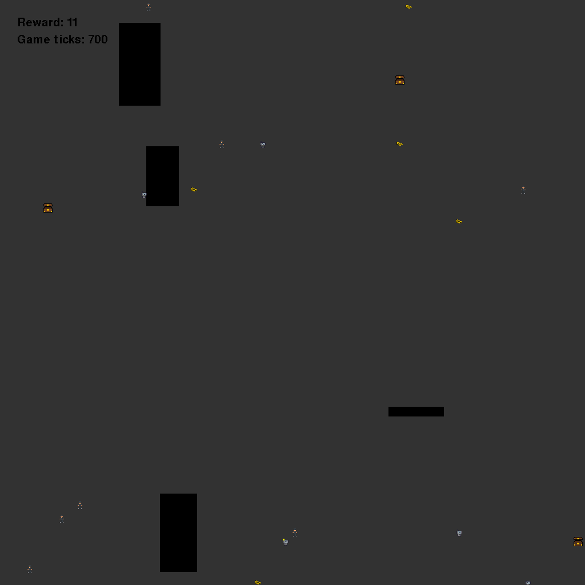

# Robot Robbers

Five robots, one city, a lot of other people's money.

You control a gang of five robot robbers on a 128x128 grid. Pick up cash bags,
carry them to a drop spot, and keep away from the scrooges who want their money
back. The more bags a robot carries to a drop-off, the more it pays, but the
heavier it gets and the easier it is to catch.



This is the case for the **Nordic AI Cup Finals 2026**. Read the
[finals README](../README.md) for dates, eligibility and how the finals are
judged.

> [!WARNING]
> **TODO(finals): the game-loop numbers are not final.** The tick count, the
> per-request timeout and the total wait budget below (3000 ticks, 2 s,
> 300 s) are still being tuned. The finals will be played with whatever is in
> [`dtos.py`](dtos.py) when they open, and any change will be announced.

## Quickstart

```cmd
git clone https://github.com/amboltio/Nordic-AI-Cup-Finals-2026
cd Nordic-AI-Cup-Finals-2026/robot-robbers
```

We recommend a virtual environment, so the dependencies stay out of your other
projects. Python 3.10 or newer.

Linux / macOS:
```bash
python3 -m venv .venv
source .venv/bin/activate
pip install -r requirements.txt
```

Windows:
```cmd
python -m venv .venv
.venv\Scripts\activate
pip install -r requirements.txt
```

Watch the baseline play:

```cmd
python local_playground.py
```

Serve it:

```cmd
python api.py
```

Then, in a second terminal, play a full game against your endpoint, exactly as
the evaluation service will:

```cmd
python local_evaluator.py
```

You now have a working endpoint and a number to improve. The baseline is a
greedy agent that plays sensibly and scores about 16 per game on average
(TODO(finals): re-measure once the tick count is final; measured at 3000
ticks over 20 maps, range -17 to 46). For comparison, standing still scores 0
and random moves score about -5.

### What is in this folder

| File | What it is |
|---|---|
| `api.py` | The FastAPI server the evaluator calls. You probably will not change it. |
| `example.py` | The greedy baseline agent. **This is the file to replace.** |
| `dtos.py` | The request and response models, plus the protocol constants. |
| `utils.py` | Reading the state, the game's walkability rule, checking your moves. |
| `local_playground.py` | Plays the game in-process: watch it, steer a robot, or score many games headless. |
| `local_evaluator.py` | Plays one game against your endpoint, the way the service does. |
| `game/environment.py` | The game itself, the same code the service runs. |
| `sample_predict_request.json` | A real mid-game request, for poking your endpoint with `curl`. |
| `requirements.txt` | Dependencies. Loose pins, so they will not fight your ML stack. |
| `Dockerfile` | If you would rather containerise the server. |

## About the game

| | Entity | How many | Controlled by |
|---|---|---|---|
|  | Robot robber | 5 | you |
|  | Scrooge | 7 | the game |
|  | Cash bag | 5 or more | the game |
|  | Drop spot | 3 | the game |
| ⬛ | Obstacle | 2 to 4 | the game |

Every game is played on a 128x128 grid. Coordinates run from `(0, 0)` in the
top-left corner to `(127, 127)`; `x` grows to the right and `y` grows
**down**. Every robot, scrooge, cash bag and drop spot occupies a single cell.

A game lasts exactly **3000 ticks** (TODO(finals): not final). On every tick
the evaluation service sends your endpoint the state of the game and you
answer with one move for each of your five robots.

### Moving your robots

Each robot moves at most one cell per tick, in any of the eight directions,
or stands still. A move is a pair `(dx, dy)` with both values in `{-1, 0, 1}`.
You send all five pairs at once, robot 0 first:

```python
moves = [
    1, 1,     # robot 0: one cell right and one cell down
    -1, 0,    # robot 1: one cell left
    0, -1,    # robot 2: one cell up
    0, 0,     # robot 3: stand still
    -1, 1,    # robot 4: one cell left and one cell down
]
```

- **A move into an obstacle or off the grid is ignored**, and the robot stays
  where it is. The whole move is ignored: a blocked diagonal does not slide
  along the obstacle.
- **Carrying slows a robot down.** A robot carrying `n` bags only moves on
  ticks where `game_ticks` is divisible by `n + 1`; on the other ticks its
  move is ignored. With no bags it moves every tick, with one bag every
  second tick, with two bags every third tick, and so on. The count is the
  global tick counter, not a per-robot timer, so the first step after a
  pickup can come sooner than `n + 1` ticks later.
- Robots do not block each other or the scrooges. Any number of them can
  share a cell. (Scrooges do block each other; see below.)

### Cash bags and drop spots

A robot on the same cell as a cash bag picks it up. There is no limit to how
many bags a robot can carry.

A robot carrying bags on the same cell as a drop spot drops off everything it
carries, and you score **the square of the number of bags dropped off**:

| Bags dropped off at once | Reward |
|---|---|
| 1 | 1 |
| 2 | 4 |
| 3 | 9 |
| 4 | 16 |
| n | n² |

Bags respawn at random free cells. Whenever fewer than five bags are in play
(on the map plus carried), every empty bag slot on the map is refilled. So the
map is topped back up to five bags even while robots are carrying some, and
between five and nine bags can be in play at once.

Drop spots never move and never run out. The three of them appear one per
tick over the first three ticks; bags appear after the first tick. **The very
first request, at `game_ticks = 0`, has no bags and no drop spots in it.**

### Scrooges

Scrooges move every second tick (on ticks where `game_ticks` is even), one
cell in any of the eight directions:

- A scrooge chases the nearest robot within a distance of **15**. The
  distance is the one the scrooge has to walk: straight-line (Euclidean) when
  nothing is in the way, otherwise the length of the shortest path around the
  obstacles, counting 1 for a straight step and √2 for a diagonal one. A robot
  that is close but only reachable by a long detour is out of range.
- A chasing scrooge steps straight towards its robot when nothing is in the
  way, and otherwise takes the first step of the shortest path around the
  obstacles.
- At most **3** scrooges chase the same robot. If more have it as their
  nearest, the 3 closest chase it and the others go for their next nearest
  robot in range, or wander.
- A scrooge with no robot to chase takes a random step, which may be
  standing still.
- A step into an obstacle, off the grid or onto another scrooge is skipped.
  Two scrooges never share a cell.

When a robot is on the same cell as a scrooge, the robot is **caught**:

- If it was carrying bags, it loses all of them and you get **-3**. The bags 
  are gone; new ones respawn elsewhere.
- Either way, the robot becomes **immune**: for **100 ticks** if it was
  carrying bags, and for **33 ticks** if it was not. While immune it cannot be
  caught again, and scrooges ignore it: they chase the nearest robot that is
  *not* immune, or wander.

Immunity is not part of the state you receive. If you want to use it, track
it yourself: you can tell a robot was caught when it was on a scrooge's cell.

### What happens in one tick

The order matters when things happen on the same cell. Each tick, the game:

1. moves your robots (those whose turn it is, see above);
2. lets every robot pick up any bags on its cell;
3. lets every carrying robot on a drop spot drop off and score;
4. catches every non-immune robot on a scrooge's cell;
5. moves the scrooges, if it is their tick;
6. respawns bags and, in the first three ticks, adds drop spots;
7. counts down every robot's immunity by one.

So a robot that steps onto a drop spot where a scrooge is standing scores
first and is caught after (losing nothing, since it just dropped off). A
scrooge that steps onto a robot in step 5 only catches it in step 4 of the
next tick, if the robot is still there.

Robots and scrooges start on random free cells. A robot can start on the
same cell as another robot or a scrooge, but no two scrooges start on the same
cell.

> [!NOTE]
> TODO(finals): the rules in this section describe the game exactly as it
> runs today. A few of them are under review and may still change before the
> finals open. Any change will be announced.

## What the evaluator sends you

One POST per tick, as JSON:

| Field | Type | Meaning |
|---|---|---|
| `state` | `int[6][10][4]` | Where everything is. See below. |
| `reward` | float | What the **previous** tick scored. `0.0` on the first request. |
| `total_reward` | float | Your score so far. |
| `game_ticks` | int | How many ticks have been played before this one: `0` on the first request, `2999` on the last. |
| `is_terminal` | bool | `true` only on the request for the last tick. |

`reward` and `total_reward` are sent as floats (`4.0`), but are always whole
numbers. After you answer the last request, its move is played and the game
ends. There is no further request, so you never see the reward of your last
move.

### Reading `state`

`state` is six rows of ten slots, and every slot is four integers
`[x, y, w, h]`:

| Row | Contents | Active slots | `w, h` |
|---|---|---|---|
| `state[0]` | Robots | always the first 5 | always `1, 1` |
| `state[1]` | Scrooges | always the first 7 | always `1, 1` |
| `state[2]` | Cash bags | up to the first 5 | always `1, 1` |
| `state[3]` | Drop spots | up to the first 3 | always `1, 1` |
| `state[4]` | Obstacles | the first 2 to 4 | size, see below |
| `state[5]` | Bags carried | the first 5 | `state[5][i][0]` is how many robot `i` carries; the rest is `0` |

Robot `i` is always `state[0][i]`, the bags it carries are always
`state[5][i][0]`, and its move is always `moves[2*i], moves[2*i + 1]`.

**An inactive slot has `x = -1`.** Always test `x`, not the whole slot,
because inactive slots come in two shapes:

- `[-1, -1, -1, -1]` for padding: slots that are never used, such as robots
  5 to 9.
- `[-1, -1, 1, 1]` for a cash bag or drop spot slot that is in use but
  currently empty, such as a bag that has just been picked up.

An obstacle `[x, y, w, h]` covers every cell from `x` to `x + w` and from `y`
to `y + h`, **both ends included**. So it is `w + 1` cells wide and `h + 1`
cells tall, and it can extend past the edge of the grid. `w` and `h` are
between 1 and 19, and obstacles can overlap. `utils.is_cell_free` is the
game's own rule for whether a cell is walkable.

`utils.parse_state` reads all of this into named lists with the inactive slots
removed:

```python
from utils import parse_state

game = parse_state(request.state)
game.robbers      # [(x, y), ...] always 5, in robot order
game.carrying     # [n, ...]      always 5, in robot order
game.scrooges     # [(x, y), ...]
game.cashbags     # [(x, y), ...]
game.dropspots    # [(x, y), ...]
game.obstacles    # [(x, y, w, h), ...]
```

[`sample_predict_request.json`](sample_predict_request.json) is a real
request from tick 700 of a game.

## What you send back

```json
{"moves": [0, -1, -1, 0, 1, 0, 0, -1, -1, 1]}
```

Exactly **ten integers**, each `-1`, `0` or `1`: `dx` and `dy` for robot 0,
then robot 1, and so on to robot 4. Anything else (the wrong length, a value
outside `{-1, 0, 1}`, a missing `moves` field, an HTTP error, a timeout) and
the service plays that tick **with no moves**, records an error, and carries
on. A bad answer costs you the tick, not the game.

## Scoring

Your score is the **total reward at the end of the game**: the sum of every
drop-off (n² each) minus 3 for every robot caught while carrying. It can be
negative.

## Timing

> [!WARNING]
> TODO(finals): not final. See the warning at the top.

The game is a fixed number of ticks, not a fixed amount of time, so a fast
agent does not get more ticks than a slow one. What speed buys you is not
losing ticks:

- **Per request:** the service waits up to **2 seconds** for each response.
  A response that does not arrive in time loses that tick, which is played
  with no moves.
- **Per game:** the service spends at most **300 seconds** in total waiting
  for your endpoint over the whole game, counting every round trip, slow or
  fast. Once that budget is used up, every remaining tick is played with no
  moves and the service stops calling you.

300 seconds over 3000 ticks is **100 ms per tick on average, network
included**. Your endpoint will be called from a server in TODO(finals):
location of the evaluation service, so measure from somewhere comparable and
leave headroom. `local_evaluator.py` reports your round-trip times and budget
use, and `--simulate-latency-ms` adds a delay to every request so you can see
how much network distance you can afford.

Requests are sent one at a time: the next tick is only requested once you
have answered the previous one.

## Validation and evaluation

Everything happens through
[finals.nordicaicup.com](https://finals.nordicaicup.com) with the API key your
team was given. Only finalist teams can submit.

**Test the connection** sends a single request and checks the shape of your reply. It is a
format check, not a speed check. Passing it does not mean you are fast enough
for a whole game.

**Validation** plays a full game on a **new random map every time**. You can
only have one attempt going at a time, but you can validate as often as you
like. Your best validation score is shown on the finals leaderboard while the
finals run. Validation games have no replays, so the first entry in each
validation attempt's error list tells you its seed instead:

```text
Info (not an error): this validation game used seed 30738956785357439708437121904581776564. Replay it locally with local_evaluator.py --seed 30738956785357439708437121904581776564.
```

Run `python local_evaluator.py --seed 30738956785357439708437121904581776564` and you get the same
map and the same game, move for move, as long as your agent makes the same
moves. Seeds are 128-bit numbers, so copy the whole seed: the map only depends
on part of it, so a shortened seed can give the right map but a different
game.

**Evaluation** plays **one game** on a fixed map that is not published, and
you get **one completed attempt only**. That score is the one the finals are
decided on. An attempt is completed even if your endpoint was down or ran out
of budget, so check that your server is up and validates cleanly right before
you submit. It stays hidden, from you as well, until it is revealed at the
award ceremony, together with replays of the evaluation games. If two teams
have the same evaluation score, the team whose evaluation attempt finished
first ranks higher.

Scores vary a lot from map to map (the baseline ranges from -17 to 46), so
judge your agent on many maps rather than one. `local_playground.py --headless
--games 50` is the fast way to do that.

## Test locally

**`local_playground.py`** runs the game in-process, with no server, so it is
the place to develop, tune and train:

```cmd
python local_playground.py                         # watch example.py play one game
python local_playground.py --keyboard              # steer robot 0 with the arrow keys
python local_playground.py --headless --games 50   # score example.py over 50 maps
python local_playground.py --seed 42 --ticks 500   # a specific map, a shorter game
```

**`local_evaluator.py`** plays a game against your running endpoint over HTTP,
with the service's tick count, timeout, budget and error handling:

```cmd
python local_evaluator.py                          # a random map, like validation
python local_evaluator.py --seed 30738956785357439708437121904581776564  # replay a validation game
python local_evaluator.py --render                 # watch while it plays
python local_evaluator.py --simulate-latency-ms 60 # pretend you are further away
```

The game is deterministic: the same seed and the same moves give the same
game on any OS, here and on the service.

If you want to work with the game directly, for example to train against it,
use the environment:

```python
from game.environment import RobotRobbersEnv

env = RobotRobbersEnv()
state = env.reset(seed=42)                        # numpy array, shape (6, 10, 4)
state, reward, is_done, info = env.step([0] * 10)
info                                              # {'total_reward': ..., 'game_ticks': ...}
```

`is_done` is always `False`; the game never ends by itself. You can change the
environment's settings (`env.max_n_scrooges`, `env.n_robbers`, ...) to make
easier practice games, but the service always plays the default game.

## Serve your endpoint

Serve your endpoint locally and check that everything starts without errors:

```cmd
python api.py
```

Open a browser at http://localhost:9055. You should see a message stating that
the endpoint is running. Feel free to change the `HOST` and `PORT` settings in
`api.py`. To send it a single request by hand:

```cmd
curl -X POST http://localhost:9055/predict -H "Content-Type: application/json" -d @sample_predict_request.json
```

There is also a `Dockerfile` if you would rather containerise it:

```cmd
docker build -t robot-robbers .
docker run -p 9055:9055 robot-robbers
```

### Make your endpoint reachable

The evaluation service has to be able to call you from the internet.

- **Cloud instance:** run the same steps on a VM from UCloud, Azure, GCP or
  AWS and open the port. This is the path we would recommend, and a VM close
  to the evaluation service keeps your round trips short.
- **Local machine:** you need the port forwarded to your machine, which
  depends on your router and is often not possible on a university network.

**The URL you submit is used exactly as given, path included.** With the
`api.py` in this folder that means `http://<your-host>:9055/predict`, not just
the host.

## OBS

Things that quietly cost points:

* **Robot `i` is the same robot all game.** Its position is `state[0][i]`, its
  bags are `state[5][i][0]`, and its move is `moves[2*i], moves[2*i + 1]`.
  Mixing up the order moves the wrong robot.
* **`y` grows downwards.** `dy = 1` moves a robot down the screen.
* **Test inactive slots on `x == -1`.** Inactive slots are not all
  `[-1, -1, -1, -1]`; see [Reading `state`](#reading-state).
* **Obstacles are one cell bigger than `w` and `h`.** A robot walking into the
  far edge of an obstacle is not moving; use `utils.is_cell_free`.
* **Handle the first request.** At `game_ticks = 0` there are no bags and no
  drop spots. An agent that takes `min()` of an empty list crashes on tick 0.
* **Send ints.** Ten of them, every tick. `utils.validate_moves` checks this,
  and `api.py` calls it on every answer.
* **Do not let your agent raise an exception.** An exception means no answer,
  and the tick is played with no moves. Catch errors and return a valid move.
* **A slow game is a lost game.** Once the 300 s budget is gone, your robots
  stand still for the rest of it. Keep the per-tick work small, warm up your
  model before you submit, and do not log every tick.
* **Your agent may keep state between ticks**, but the service plays one game
  per attempt and does not tell you when a new one starts, other than
  `game_ticks = 0`. Reset your state when you see it.
